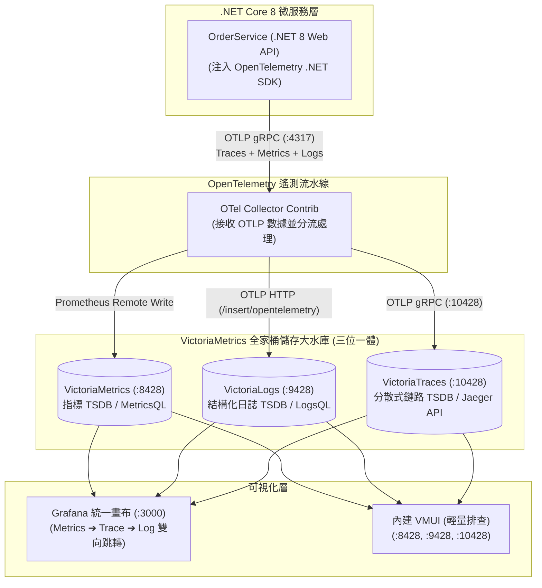

# OpenTelemetry + VictoriaMetrics 全家桶 .NET Core 8 實戰範例

[](https://github.com/windcoldchen/otel-victoriametrics-dotnet-demo/actions/workflows/ci.yml)
[](LICENSE)
[](https://dotnet.microsoft.com/)

> 本專案為 **OpenTelemetry (OTel)** 結合 **VictoriaMetrics 全家桶 (VictoriaMetrics + VictoriaLogs + VictoriaTraces)** 的端到端生產級示範專案。應用程式採用 **C# / .NET 8 (ASP.NET Core Web API)** 開發，完整展示**時序指標 (Metrics)**、**結構化日誌 (Logs)** 與**分散式鏈路追蹤 (Traces)** 的收集、分流儲存與跨維度聯動。

---

## 1. 系統架構全景

本範例實踐了**「前端採集大一統，後端儲存極致化」**的架構理念：



---

## 2. 核心技術棧清單

| 組件 | 角色定位 | 監聽埠號 | 說明 |
| :--- | :--- | :--- | :--- |
| **OrderService** | 業務微服務 (.NET 8) | `:8080` | 提供訂單建立、慢查詢模擬與例外觸發 API，整合 OTel SDK |
| **OTel Collector** | 遙測數據分流中樞 | `:4317` (gRPC), `:4318` (HTTP) | 接收應用遙測並分發至對應的 Victoria 儲存 |
| **VictoriaMetrics** | 時序指標儲存 (Metrics) | `:8428` | 高性能 TSDB，儲存 ASP.NET Core 指標與業務自定義 Metric |
| **VictoriaLogs** | 結構化日誌儲存 (Logs) | `:9428` | 原生免疫高基數，儲存具備 `trace_id` 綁定的 ILogger 輸出 |
| **VictoriaTraces** | 鏈路追蹤儲存 (Traces) | `:10428` | 儲存 OTLP Spans，100% 相容 Jaeger Query API |
| **Grafana** | 統一可視化分析 | `:3000` | 預先配置三種數據源與 Exemplar/DataLink 雙向聯動 |

---

## 3. 快速上手 (Quick Start)

### 步驟 1：啟動完整環境

確保主機已安裝 Docker 與 Docker Compose，於本專案根目錄執行：

```bash
docker compose up -d --build
```

確認所有容器皆處於 Healthy / Running 狀態：

```bash
docker compose ps
```

---

### 步驟 2：觸發 API 產生觀測性數據

你可以存取 Swagger UI 進行互動式呼叫：`http://localhost:8080/swagger`，或直接使用 `curl`：

#### A. 建立正常訂單 (產生 Metrics, Logs 與巢狀 Spans)

```bash
curl -X POST http://localhost:8080/api/orders \
  -H "Content-Type: application/json" \
  -d '{
    "customerId": "CUST-1001",
    "product": "Mechanical Keyboard",
    "amount": 159.99
  }'
```

#### B. 查詢訂單列表

```bash
curl http://localhost:8080/api/orders
```

#### C. 觸發慢呼叫 (在鏈路追蹤觀察長 Span 瀑布圖)

```bash
curl http://localhost:8080/api/orders/slow
```

#### D. 觸發錯誤例外 (觀察 500 錯誤率、Error Span 與 Error 日誌)

```bash
curl http://localhost:8080/api/orders/error
```

---

## 4. 驗證與跨維度跳轉體驗

### 1. 存取 Grafana 統一畫布

- **URL**：`http://localhost:3000`
- **帳號**：`admin`
- **密碼**：`admin`

已預先配置好三大資料來源：
- **VictoriaMetrics** (Prometheus 類型，已啟用 Exemplars)
- **VictoriaLogs** (`victorialogs-datasource` 官方插件)
- **VictoriaTraces** (Jaeger 類型，已設定 Trace to Logs Data Links)

#### 跨維度無縫聯動體驗：
1. **指標 ➔ 鏈路 (Metric ➔ Trace via Exemplars)**：在指標面版中點擊異常突波星號，直接跳轉展開 VictoriaTraces 的 Trace 瀑布圖。
2. **鏈路 ➔ 日誌 (Trace ➔ Log via Data Links)**：在 Jaeger 鏈路面版中點擊任何 Span，右側即刻自動帶入 `trace_id` 在 VictoriaLogs 中檢索該次請求列印的所有日誌！

---

### 2. 存取內建輕量 VMUI (即開即用，無需 Grafana)

- **VictoriaMetrics VMUI**：`http://localhost:8428/vmui`
  - 查詢指標：`orders_created_total`、`http_server_request_duration_seconds_count`
- **VictoriaLogs Web UI**：`http://localhost:9428/select/vmui`
  - 查詢日誌：`_time:1h AND service.name:OrderService`
- **VictoriaTraces Web UI**：`http://localhost:10428/select/vmui`
  - 查詢鏈路：依據服務名稱 `OrderService` 檢視所有分散式呼叫瀑布圖。

---

## 5. 專案目錄結構

```text
├── src/
│   └── OrderService/
│       ├── Controllers/
│       │   └── OrdersController.cs   # API 控制器 (觸發指標、日誌與鏈路)
│       ├── Diagnostics/
│       │   └── AppMetrics.cs         # ActivitySource (Traces) 與 Meter (Metrics)
│       ├── Models/
│       │   └── Order.cs              # 業務領域模型
│       ├── Dockerfile                # 多階段容器構建
│       ├── OrderService.csproj       # OpenTelemetry 8.0 套件引用
│       └── Program.cs                # OTel SDK 註冊與管道中介軟體
├── grafana/
│   └── provisioning/
│       ├── datasources/
│       │   └── datasources.yaml      # 預先掛載 VM、VictoriaLogs、VictoriaTraces
│       └── dashboards/
│           └── dashboards.yaml       # 儀表板自動加載配置
├── docker-compose.yml                # 一鍵編排 6 大核心容器
├── otel-collector-config.yaml        # OTel Collector 分流輸出配置
├── OrderService.sln                  # 方案檔
└── README.md
```

---

## 6. 授權與社群

- 本專案採用 [MIT License](LICENSE) 授權釋出。
- 歡迎提交 PR 或 Issue 與我們一同推進雲原生可觀測性最佳實踐！
