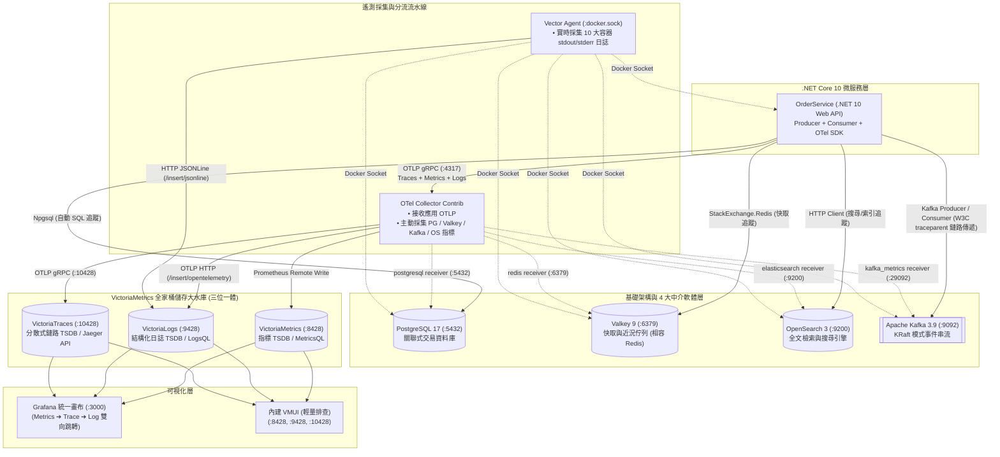
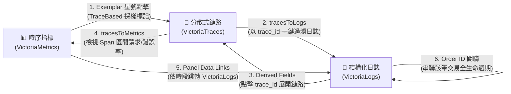
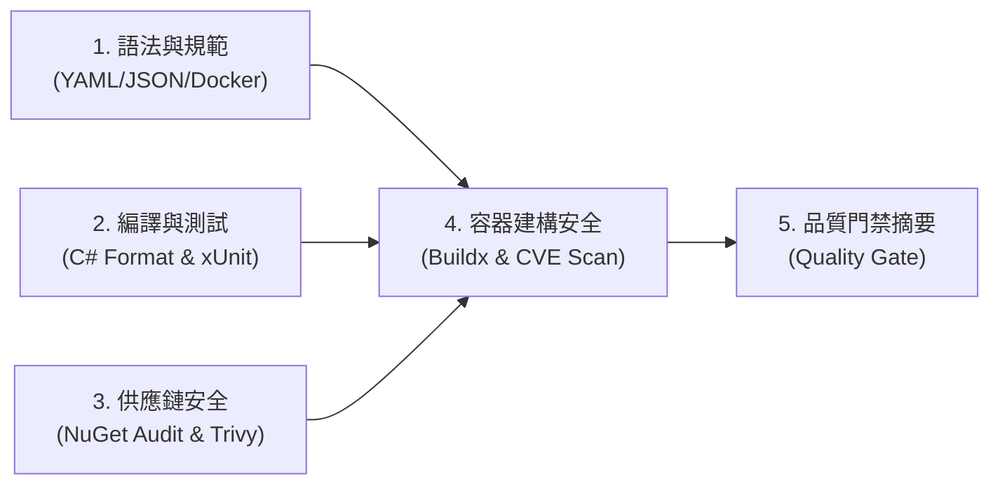

# OpenTelemetry + VictoriaMetrics 全家桶 .NET Core 10 實戰範例

[](https://github.com/windcoldchen/otel-victoriametrics-dotnet-demo/actions/workflows/ci.yml)
[](LICENSE)
[](https://dotnet.microsoft.com/)

> 本專案為 **OpenTelemetry (OTel)** 結合 **VictoriaMetrics 全家桶 (VictoriaMetrics + VictoriaLogs + VictoriaTraces)** 的端到端生產級示範專案。應用程式採用 **C# / .NET 10 (ASP.NET Core Web API)** 開發，完整展示**時序指標 (Metrics)**、**結構化日誌 (Logs)** 與**分散式鏈路追蹤 (Traces)** 的收集、分流儲存與跨維度聯動。

---

## 1. 系統架構全景

本範例實踐了**「前端採集大一統，後端儲存極致化」**與**「真實微服務 + 4 大中介軟體 (Valkey, Kafka, OpenSearch, Postgres) 360 度觀測聯動」**：



---

## 2. 核心技術棧清單

| 組件 | 角色定位 | 監聽埠號 | 遙測信號採集方式 (Metrics / Logs / Traces) |
| :--- | :--- | :--- | :--- |
| **OrderService** | 業務微服務 (.NET 10) | `:8080` | **Metrics**: OTel .NET SDK (Exemplars)<br/>**Logs**: ILogger OTLP 輸出<br/>**Traces**: 整合 HTTP, SQL, Redis, Kafka Producer & Consumer |
| **PostgreSQL** | 關聯式交易資料庫 | `:5432` | **Metrics**: OTel `postgresql` receiver (連線、交易、Block Reads)<br/>**Logs**: SQL 執行與耗時 stderr ➔ Vector 收集<br/>**Traces**: `Npgsql.OpenTelemetry` 自動注入 SQL Spans |
| **Valkey 9** | 記憶體快取與佇列 | `:6379` | **Metrics**: OTel `redis` receiver (記憶體、Clients、Keyspace)<br/>**Logs**: Valkey 伺服器輸出 ➔ Vector 收集<br/>**Traces**: `StackExchangeRedis` 儀器化追蹤快取指令 |
| **Apache Kafka 3.9** | 分散式事件串流 | `:9092` | **Metrics**: OTel `kafka_metrics` receiver (Broker、Topics、Consumer Lag)<br/>**Logs**: Broker stdout ➔ Vector 收集<br/>**Traces**: W3C `traceparent` Header 串聯 Producer 與 Consumer |
| **OpenSearch 3** | 全文檢索引擎 | `:9200` | **Metrics**: OTel `elasticsearch` receiver (Cluster Health, JVM, Shards)<br/>**Logs**: OpenSearch 叢集輸出 ➔ Vector 收集<br/>**Traces**: `HttpClientInstrumentation` 自動追蹤 REST 查詢 |
| **OTel Collector** | 遙測數據分流中樞 | `:4317`, `:4318`, `:8888` | 接收應用遙測並主動 Scrape 4 大中介軟體指標，分流至 Victoria 全家桶 |
| **Vector** | 容器日誌收集器 | (內網) | 監聽 Docker Socket，即時收集所有容器的 stdout/stderr 並匯入 VictoriaLogs |
| **VictoriaMetrics** | 時序指標儲存 (Metrics) | `:8428` | 高性能 TSDB，儲存微服務與 4 大中介軟體指標，支援 Exemplars |
| **VictoriaLogs** | 結構化日誌儲存 (Logs) | `:9428` | 原生免疫高基數，儲存微服務結構化日誌與所有容器原生日誌 |
| **VictoriaTraces** | 鏈路追蹤儲存 (Traces) | `:10428` | 儲存微服務與中介軟體連鎖 Span，100% 相容 Jaeger Query API |
| **Grafana** | 統一可視化分析 | `:3000` | 預設自動加載 360 度觀測看板，打通 Metrics ⟷ Traces ⟷ Logs |

---

## 3. 快速上手 (Quick Start)

### 步驟 1：啟動完整環境

確保主機已安裝 Docker 與 Docker Compose，於本專案根目錄執行：

```bash
docker compose up -d --build
```

確認所有容器皆處於 Healthy / Running 狀態：

```bash
docker compose ps
```

---

### 步驟 2：觸發 API 產生多維觀測性數據

你可以存取 Swagger UI 進行互動式呼叫：`http://localhost:8080/swagger`，或直接使用一鍵測試流量腳本：

```bash
# 一鍵自動發送多維度測試流量 (涵蓋正常交易、快取、檢索、慢查詢與 500 錯誤)
./scripts/generate-traffic.sh
```

亦可使用 `curl` 單獨手動觸發各項情境：

#### A. 建立訂單 (觸發 PG 寫入、Valkey 快取、OpenSearch 索引與 Kafka 事件發布)

```bash
curl -X POST http://localhost:8080/api/orders \
  -H "Content-Type: application/json" \
  -d '{
    "customerId": "CUST-1001",
    "product": "Mechanical Keyboard",
    "amount": 159.99
  }'
```

> **鏈路觀察亮點**：在 VictoriaTraces 中可看見該次請求完整的階層瀑布圖：
> `POST /api/orders` ➔ `CheckInventory` ➔ `ProcessPayment` ➔ `Npgsql: INSERT INTO orders` ➔ `Redis: SET / LPUSH` ➔ `HTTP POST opensearch:9200` ➔ `KafkaProduce:orders.events`。

#### B. 查詢最新訂單列表 (優先讀取 Valkey 9 快取)

```bash
curl http://localhost:8080/api/orders
```

#### C. 使用 OpenSearch 3 進行全文檢索

```bash
curl "http://localhost:8080/api/orders/search?q=Keyboard"
```

#### D. 觸發慢呼叫 (在鏈路追蹤觀察長 Span 瀑布圖)

```bash
curl http://localhost:8080/api/orders/slow
```

#### E. 觸發錯誤例外 (觀察 500 錯誤率、Error Span 與 Error 日誌)

```bash
curl http://localhost:8080/api/orders/error
```

---

## 4. 驗證與 360 度跨維度串接體驗 (Metrics ⟷ Traces ⟷ Logs)

本專案已打通可觀測性三大支柱的所有雙向路徑，實現真正的 **360° 互相串接**：



### 1. 存取 Grafana 統一畫布與預設自動看板

- **URL**：`http://localhost:3000`
- **帳號**：`admin`
- **密碼**：`admin`
- **預置專屬儀表板庫**：登入後即可在 Dashboards 列表查看已預先 Provisioning 完成的 5 個核心看板，並支援頂部橫幅互相跳轉：
  1. 🌟 **`OrderService - 全方位可觀測性看板`** (`/d/orders-360-observability`)：微服務業務、RED 指標、日誌串流與全鏈路聯動。
  2. ⚡ **`Valkey 9 - 高速快取與記憶體資料庫監控`** (`/d/valkey-9-dashboard`)：Uptime、客戶端連線、記憶體用量、命中率（Hits/Misses）與即時容器日誌。
  3. ⚡ **`Apache Kafka 3.9 - 串流中樞與消費者延遲監控`** (`/d/kafka-39-dashboard`)：Broker 訊息吞吐、Topic 訊息產出率、Consumer Group Lag 延遲、W3C 鏈路說明與原生日誌。
  4. ⚡ **`OpenSearch 3 - 分散式搜尋與檢索引擎監控`** (`/d/opensearch-3-dashboard`)：叢集健康狀態 (Green/Yellow/Red)、JVM 記憶體佔用、索引文件量、寫入/查詢吞吐與即時日誌。
  5. ⚡ **`PostgreSQL 17 - 關聯式交易資料庫核心效能監控`** (`/d/postgresql-17-dashboard`)：連線池占用率、TPS (Commit/Rollback)、快取命中率、死鎖/鎖等待與容器慢查詢/語句日誌。

---

### 2. 實戰體驗六大雙向串接路徑

#### ① 指標 ➔ 鏈路 (Metrics ➔ Traces via Exemplars)
- **實踐原理**：.NET 10 在 `Program.cs` 啟用了 `.SetExemplarFilter(ExemplarFilterType.TraceBased)`。在調用 API 過程中，只要存在活躍的 Span，OpenTelemetry 就會自動將 `TraceId` 注入到延遲與金額指標中。
- **操作步驟**：
  1. 在 Grafana 看板的「HTTP 請求延遲 P95 / P50」圖表中，會看到懸浮在曲線旁的藍色/粉色星號（Exemplars）。
  2. 將滑鼠懸停於星號上方，會顯示具體的 `TraceID`。
  3. 點擊星號，右側直接滑出展開 **VictoriaTraces** 的完整呼叫鏈路瀑布圖！

#### ② 鏈路 ➔ 日誌 (Traces ➔ Logs via tracesToLogs)
- **實踐原理**：Grafana Jaeger 數據源中配置了 `tracesToLogs`，自動帶入當前 Span 的 `trace_id` 並指定時間範圍查詢 VictoriaLogs。
- **操作步驟**：
  1. 在 VictoriaTraces 的 Trace 瀑布圖中，點選任何一個感興趣的 Span（例如 `Npgsql: INSERT INTO orders` 或 `ProcessPayment`）。
  2. 點擊右側的 **"Trace to logs"** 按鈕。
  3. 畫面即刻自動切換/分頁至 **VictoriaLogs**，精確列出該次交易在微服務中印出的所有日誌！

#### ③ 日誌 ➔ 鏈路 (Logs ➔ Traces via Derived Fields)
- **實踐原理**：`victoriametrics-logs-datasource` 設定了 `derivedFields`，自動偵測日誌內含的 32 位元 `trace_id`，並渲染為直接跳轉鏈接。
- **操作步驟**：
  1. 在 Grafana 的 VictoriaLogs 查詢面板中，展開任一條日誌。
  2. 在欄位列表可以看到 `trace_id` 旁多出了一個 **`View in VictoriaTraces`** 按鈕。
  3. 點擊該按鈕，立刻為您在 VictoriaTraces 中打開該筆日誌所屬的完整分散式鏈路。

#### ④ 鏈路 ➔ 指標 (Traces ➔ Metrics via tracesToMetrics)
- **實踐原理**：在 VictoriaTraces 中配置了對應的服務標籤關聯。
- **操作步驟**：在鏈路 Span 詳細資訊中，點擊 **"Trace to metrics"**，能即時調出該服務在當前時間點前後的 HTTP 請求率與錯誤率圖形。

#### ⑤ 指標 ➔ 日誌 (Metrics ➔ Logs via Panel Data Links)
- **實踐原理**：儀表板面板中配置了動態 Data Links。
- **操作步驟**：點擊「5xx 錯誤率」面板或延遲異常突波時，點擊選單中的 **`🚨 檢視 VictoriaLogs 錯誤日誌`**，系統自動帶入時間範圍 `${__from}` 至 `${__to}` 並過濾 `log.level:ERROR`，直接呈現對應的故障現場日誌。

#### ⑥ 日誌 ➔ 關聯日誌 (Logs ➔ Logs via Order ID)
- **操作步驟**：在 VictoriaLogs 中點擊任何訂單編號（如 `ORD-XXXXXXXX`），自動透過衍生欄位過濾該訂單從 PostgreSQL 寫入、Valkey 快取、OpenSearch 索引到 Kafka 事件發布的所有事件。

---

### 3. 存取內建輕量 VMUI (即開即用，無需 Grafana)

- **VictoriaMetrics VMUI**：`http://localhost:8428/vmui`
  - 查詢指標：`orders_created_total`、`orders_valkey_cache_hits_total`、`orders_kafka_messages_published_total`、`http_server_request_duration_seconds_count`
- **VictoriaLogs Web UI**：`http://localhost:9428/select/vmui`
  - 查詢日誌：`_time:1h AND service.name:OrderService`
  - 依 TraceID 檢索：`trace_id:"<你的 TraceId>"`
- **VictoriaTraces Web UI**：`http://localhost:10428/select/vmui`
  - 查詢鏈路：依據服務名稱 `OrderService` 檢視所有跨中介軟體呼叫瀑布圖。

---

## 5. 軟體開發標準 CI 流水線 (Enterprise Standard CI)

本專案建立了標準化、自動化的五階段 CI 流程，並於 [.github/workflows/ci.yml](.github/workflows/ci.yml) 中配置：



### 五大核心階段：
1. **靜態語法與規範 (Syntax & Lint)**：
   - 遞迴校驗所有 YAML 與 JSON 配置（包含 Vector 設定與組態）。
   - Dockerfile (Hadolint) 與 Docker Compose 規範結構檢查。
   - **`otelcol validate`**：使用 OpenTelemetry Collector 驗證 `otel-collector-config.yaml` 接收器、處理器與導出器管道語法。
   - **`dashboard-linter`**：透過 Grafana 官方 `ghcr.io/grafana/dashboard-linter` 檢驗所有 5 套儀表板設計與語法規範。
2. **編譯、單元測試與代碼覆蓋率 (Build & Tests)**：
   - 自動快取 NuGet 相依套件。
   - `dotnet format --verify-no-changes` 強制保持代碼風格一致。
   - `dotnet build --warnaserror` 嚴格確保零編譯警告。
   - 執行 xUnit 單元測試並收集 Cobertura 覆蓋率報告，自動上傳至 GitHub Artifacts。
3. **軟體供應鏈安全 (Security & SCA)**：
   - `dotnet list package --vulnerable` 檢查套件已知 CVE 弱點。
   - 執行 Aqua Trivy 檔案系統與依賴套件安全掃描。
4. **容器映像檔建構、安全與發布 (Docker Build, Scan & GHCR Push)**：
   - 透過 Docker Buildx 與 GitHub Cache 加速多階段映像檔建構。
   - 執行 Trivy 容器映像檔 CVE 漏洞掃描 (嚴格把關安全)。
   - **自動發布**：當合併至 `main` 分支且 .NET Core 程式有變更時，自動推送映像檔至 GitHub Container Registry (`ghcr.io/${{ github.repository }}`)。
5. **品質門禁決策總結 (Quality Gate Summary)**：
   - 於 `$GITHUB_STEP_SUMMARY` 自動生成 Markdown 執行矩陣與合併決策。

#### 💻 本地一鍵模擬 CI 流水線
開發者在提交程式碼前，可在本機終端機直接執行與 CI 完全一致的檢驗：
```bash
# 完整 CI 流程驗證 (語法檢查 + C# 格式化 + 單元測試 + Docker 鏡像建構)
./scripts/run-ci-local.sh

# 僅快速檢查所有 YAML / JSON / Compose 語法
./scripts/validate-syntax.sh
```

---

## 6. 專案目錄結構

```text
├── src/
│   └── OrderService/
│       ├── Controllers/
│       │   └── OrdersController.cs         # API 控制器 (整合 PG、Valkey、OpenSearch、Kafka)
│       ├── Diagnostics/
│       │   └── AppMetrics.cs               # ActivitySource (Traces) 與 Meter (Metrics)
│       ├── Models/
│       │   └── Order.cs                    # 業務領域模型
│       ├── Services/
│       │   ├── DataStoreInitializer.cs     # 容器啟動時的 Schema 與 Index 自動初始化
│       │   └── OrderProcessingConsumer.cs  # Kafka 事件消費者 (延續 W3C 鏈路追蹤)
│       ├── Dockerfile                      # 多階段容器構建 (.NET 10)
│       ├── OrderService.csproj             # OpenTelemetry 與中介軟體客戶端套件引用
│       └── Program.cs                      # DI 註冊、中介軟體連線與 OTel 管道
├── tests/
│   └── OrderService.Tests/
│       ├── OrderTests.cs                   # 業務模型單元測試
│       ├── AppMetricsTests.cs              # 可觀測性指標與診斷單元測試
│       └── OrderService.Tests.csproj       # xUnit 與 Coverlet 覆蓋率測試專案
├── grafana/
│   └── provisioning/
│       ├── datasources/
│       │   └── datasources.yaml            # 預先掛載 VM、VictoriaLogs、VictoriaTraces (含雙向聯動)
│       └── dashboards/
│           ├── dashboards.yaml             # 儀表板自動加載配置
│           ├── order-observability-360.json# 360 度全方位可觀測性看板
│           ├── valkey-dashboard.json       # Valkey 9 專屬監控看板
│           ├── kafka-dashboard.json        # Apache Kafka 3.9 專屬監控看板
│           ├── opensearch-dashboard.json   # OpenSearch 3 專屬監控看板
│           └── postgresql-dashboard.json   # PostgreSQL 17 專屬監控看板
├── .github/
│   └── workflows/
│       └── ci.yml                          # 企業級標準 CI 流水線
├── scripts/
│   ├── generate-traffic.sh                 # 自動化多維度可觀測性測試流量產生腳本
│   ├── run-ci-local.sh                     # 本地標準 CI 流水線執行腳本
│   └── validate-syntax.sh                  # 本地與 CI 語法檢查驗證腳本
├── docker-compose.yml                      # 一鍵編排 11 大核心容器
├── otel-collector-config.yaml              # OTel Collector 分流輸出與 4 大中介軟體 Scraper
├── vector.yaml                             # Vector 容器日誌收集器配置
├── OrderService.sln                        # 方案檔
└── README.md
```

---

## 6. 授權與社群

- 本專案採用 [MIT License](LICENSE) 授權釋出。
- 歡迎提交 PR 或 Issue 與我們一同推進雲原生可觀測性最佳實踐！
